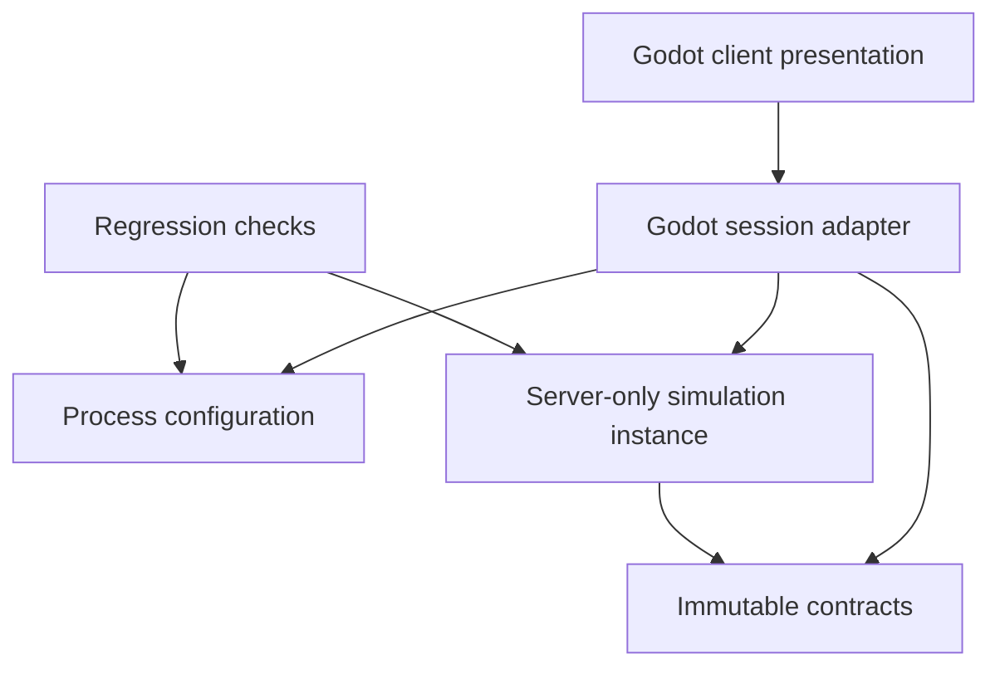

# Architecture

The first implemented slice is an authoritative two-player duel. Repository boundaries should survive replacing its renderer, transport, rules or hosting system. They do not make this prototype an MMO by themselves.

`ArenaSession` is the composition point: on the client it creates `ArenaView` and maintains received snapshots; on the server it creates `ArenaSimulation` and never constructs a view. Both peers load the same root scene/node path and RPC declarations. A common Godot assembly is intentional for this first slice; server code in that assembly is not a security secret. Separate client/server artifacts become useful when exports and content sizes justify them.

## Runtime responsibilities

| Component | Owns | Must not own |
| --- | --- | --- |
| Contracts | Immutable boundary data | Godot types, domain mutation, persistence models |
| Simulation | Movement, range, health, casting, cooldowns, respawn | Engine objects, network calls, wall clock, database calls |
| Hosting | Explicit CLI/environment validation | Cloud credentials, service discovery or gameplay rules |
| Session adapter | Transport identity, RPC mapping, server tick, composition | Detailed combat rules, client drawing |
| Presentation | Input, visuals, local selection | Trusted damage, authority or account identity |

The host advances simulation in Godot's physics callback; the default tick is 60 Hz and snapshots are sent at 10 Hz. Simulation time advances only on server ticks, including cooldowns and respawns. It is not a deterministic lockstep engine: floating-point arithmetic and iteration order are not a cross-platform replay guarantee. Future physics/collision modules need explicit stepping and reproducibility tests before any replay claim.

There is one writer for each arena's in-memory state. Client RPCs contain intent; the server obtains peer identity from transport and validates the command. A peer ID is not an authenticated account. Future identity admission belongs at the host boundary before joining a simulation.

## Contract changes

`FighterSnapshot` is an in-process immutable DTO. `ArenaSession` maps it to Godot RPC arguments; it is not a versioned binary protocol or a persistence format. RPC names, parameter order/types and scene/node paths currently require identical client/server builds. Deploy those builds together for development. No rolling protocol compatibility is claimed.

Before independently deploying clients and servers, introduce a version handshake, compatible-version policy, bounded message sizes, sequence/tick IDs, reconnect/full-state reconciliation, rate limits and protocol fixtures. Unreliable per-fighter state can be reordered and does not yet have sequence numbers. That limitation must be addressed before production replication. Domain entities must never become database rows or public APIs by accident.

## Growth rules

Create features around bounded gameplay responsibilities (combat, inventory, quests), with explicit public contracts and private implementations. Keep engine physics adapters separate from pure rules; clients can predict movement later, but server collision and combat remain authoritative. Give animation/rendering teams read models and events, not access to mutable server entities. Pass dependencies through constructors or the host composition point.

Online services own their databases and communicate by versioned APIs/events. There are no cross-service database joins or direct references from simulation to service SDKs. Long-running persistence/network operations must not run inside the simulation tick. Use idempotent commands and a durable outbox when durable event delivery is implemented.

See [the initial ADR](decisions/0001-modular-foundation.md), [regional design](../operations/regional-hosting.md), and [milestones](roadmap.md). Component dependencies are declared in `catalog/components.json` and checked in CI.
