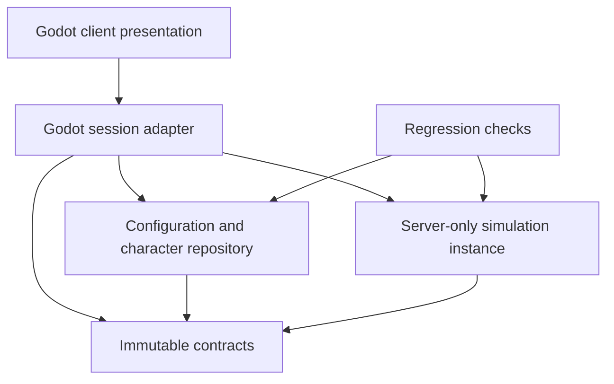

# Architecture

The implemented slice is a continuously running outdoor world with authoritative Warrior, Mage and Archer combat, Woodvale forest art, four passive wandering monster species and levels 1–10 with ranked skills. SQLite account-owned character aggregates persist across reconnects and restarts. Login and gameplay run over verified TLS WebSockets. Large-scale hosting remains future work.

`ArenaSession` is the composition point: on the client it creates `ArenaView` and maintains received snapshots; on the server it creates `WorldSimulation` and never constructs a view. Both peers load the same root scene/node path and RPC declarations. Historical scene names and UIDs remain intact. A common Godot assembly is intentional; server code in that assembly is not a security secret. Separate client/server artifacts become useful when exports and content sizes justify them.

## Runtime responsibilities

| Component | Owns | Must not own |
| --- | --- | --- |
| Contracts | Immutable boundary/read models and versioned character save DTO | Godot types, domain mutation, database implementation |
| Simulation | Movement, combat, respawn, contributions, EXP and rank validation | Engine objects, network calls, wall clock, database calls |
| Hosting | CLI/environment validation and interface-backed development saves | Cloud credentials, service discovery or gameplay rules |
| Session adapter | Transport identity, RPC mapping, server tick, composition | Detailed combat rules, client drawing |
| Presentation | Input, visuals, interpolation, displayed authoritative target | Trusted damage, authority or account identity |

The host advances simulation in Godot's physics callback; the default tick is 60 Hz and snapshots are sent at 15 Hz. Simulation time advances only on server ticks, including cooldowns and respawns, even when the world is empty. It is not a cross-platform deterministic lockstep engine. Navigation, collision and combat use controlled-time regression checks; no cross-platform replay guarantee is claimed.

There is one writer for the world's in-memory state. Client RPCs contain intent; the server maps transport peer identity to a server-assigned entity and validates sequence, age, rate and gameplay conditions. Stable character GUIDs are distinct from entity IDs. The server authenticates the account on its TLS connection and validates ownership before binding a selected character. See [ADR 0009](decisions/0009-account-characters.md).

## Contract changes

`EntitySnapshot`, `WorldSnapshot` and `CombatEvent` are immutable DTOs. `ArenaSession` sends Brotli-compressed snapshot JSON and reliable JSON events in Godot RPCs; they are not persistence formats. RPC names, types, JSON shapes and scene/node paths require identical client/server builds. Restart those builds together for development. No rolling protocol compatibility is claimed.

Full-state snapshots carry increasing revisions and reject reordered delivery. Combat changes and events are reliable; movement snapshots also use reliable delivery over TLS WebSockets. Command sequence/age/rate admission is implemented. Monster species/state extend the same snapshots; only the server owns AI. Before independently deploying clients and servers, add protocol negotiation, measured bandwidth budgets, area-of-interest filtering, durable identity and latency/load testing. Domain entities must never become database rows or public APIs by accident.

The original art manifest and authored forest JSON are embedded as validated engine-independent content. `WorldMap` derives authoritative terrain/prop blockers from these definitions; the client derives TileMapLayers, sprite placements and matching physics footprints. No runtime PNGs or rendering nodes are loaded on the dedicated server. See [ADR 0003](decisions/0003-woodvale-world-content.md) for the content boundary and [world data](../../content/worlds/README.md) for editing instructions.

## Growth rules

Schema 4 adds branching skills, server cooldown deadlines and shield ownership. See [ADR 0008](decisions/0008-skill-tree-and-combat-ui.md) for the transaction, hit order and hotbar boundaries.

Progression uses private owner snapshots and public level/level-up events. Simulation consumes authored rank/EXP data and exports immutable save records; the adapter schedules atomic file writes off the simulation thread. Read [ADR 0005](decisions/0005-character-progression.md) and [progression tuning](../../content/progression/README.md) before changing identity, reward or persistence boundaries.

Inventory extends that same character aggregate and save queue. Pure mutation preparation validates capacity, identities, metadata, quantities and revisions; owner RPCs are acknowledged after the durable save. Client snapshots omit operation receipts and never expose other backpacks. Read [ADR 0006](decisions/0006-persistent-inventory.md) and the [item catalog guide](../../content/items/README.md) before changing inventory transactions, migration or future loot/crafting/trade ownership boundaries.

Loot, two equipment slots and direct-use crafting extend the same aggregate in schema 3. Equipment and pickup move existing instance identities; crafting creates one output only after validating its complete inputs. [ADR 0007](decisions/0007-loot-equipment-crafting.md) describes the durable commit boundary, contribution-based protection, transient world drops and the narrow synchronous JSON-save exception used by development economy operations.

Combat presentation uses replaceable animation strips and skill bindings, driven by the same snapshots and reliable events. Event geometry and snapshot death/dash timestamps provide visual context without changing simulation rules. See [ADR 0004](decisions/0004-authoritative-combat-presentation.md) for playback, instant-hit projectile travel, late-state reconciliation and test boundaries.

Create features around bounded gameplay responsibilities (combat, inventory, quests), with explicit public contracts and private implementations. Keep engine physics adapters separate from pure rules; clients can predict movement later, but server collision and combat remain authoritative. Give animation/rendering teams read models and events, not access to mutable server entities. Pass dependencies through constructors or the host composition point.

Online services own their databases and communicate by versioned APIs/events. There are no cross-service database joins or direct references from simulation to service SDKs. Long-running persistence/network operations must not run inside the simulation tick. Use idempotent commands and a durable outbox when durable event delivery is implemented.

See [the initial ADR](decisions/0001-modular-foundation.md), [shared-world combat ADR](decisions/0002-shared-world-combat.md), [combat guide](combat-mvp.md), [regional design](../operations/regional-hosting.md), and [milestones](roadmap.md). Component dependencies are declared in `catalog/components.json` and checked in CI.
