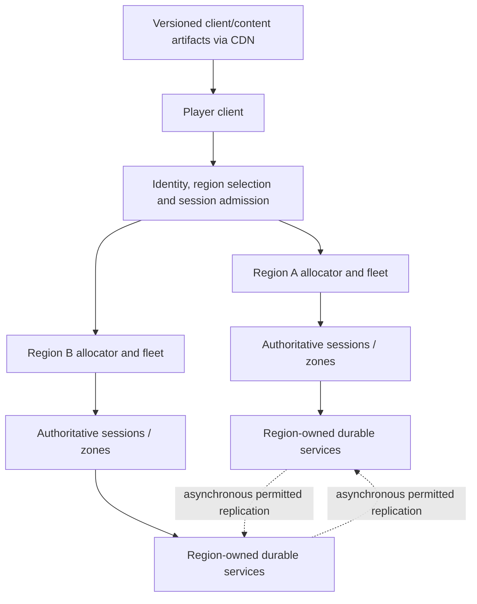

# Regional hosting design

This is a target design, not deployed infrastructure. The implemented host is one Godot process running a continuously ticking outdoor world with three-class combat and development character progression saves. Its 32-player admission limit is unbenchmarked. It accepts validated bind/port/region/shard settings. Region/shard labels do not allocate infrastructure; the shard label selects a local development save directory unless `--data-dir` overrides it.

## Capacity and authority

Start with a fleet of independent sessions. One process owns a session's mutable state and advertises a directly reachable UDP endpoint through an allocator. For a persistent world, introduce zones/shards with explicit entity ownership and tested transfers; do not stretch one simulation tick across distant regions. Clients choose an eligible region using measured latency, capacity and account/data constraints.

Estimate session count from `peak concurrent players / measured players per session`, then include spare capacity and failure headroom. Measure CPU time per physics tick, memory per session, ingress/egress, packet loss, replication fan-out, startup latency and allocator latency. At 60 Hz, a tick has about 16.7 ms; reserve headroom rather than consuming the full budget. Autoscaling should consider ready session slots, queue time and tick pressure, with an upper cost/quota limit. Player count alone is not enough.

Keep a single authoritative writer for character/economy state. Cross-region copies can serve explicitly stale reads or recovery needs; they must not create conflicting authoritative writes. Choose residency, RPO and RTO per data class before provisioning. Inventory/currency mutations require idempotency and auditability. Ownership transfer needs fencing/leases and recovery tests; none exists in the prototype.

## Required server lifecycle

1. Start an immutable, pinned dedicated-server artifact with explicit region, shard/session ID and networking configuration. Bind `0.0.0.0` only in the intended network boundary; configure advertised endpoints separately from bind addresses.
2. Load and validate content/configuration before reporting ready. Liveness indicates a healthy process/tick; readiness indicates that allocation can succeed. The current startup log is not an orchestrator health endpoint.
3. Admit only version-compatible, authenticated, short-lived session tickets. Apply connection, command, message-size and bandwidth limits. The current transport has no account authentication or abuse controls.
4. On drain, stop allocating new sessions, finish or checkpoint existing work under a deadline, release leases, flush telemetry and exit. The current host closes peers on normal scene exit; production draining/checkpointing is unimplemented.
5. Treat process loss as failure. Recover from durable state or explicitly abandon the session. Do not report transparent failover until crash/replay/transfer behavior is tested.

For export mechanics, use Godot's [dedicated-server guidance](https://docs.godotengine.org/en/stable/tutorials/export/exporting_for_dedicated_servers.html). Headless execution avoids a display requirement, but production export, content stripping, container construction and artifact verification are still required here.

## Releases and operations

Build once and promote immutable digests per region. Before compatibility negotiation exists, development clients and servers must use the same build. Later, declare a supported protocol window, canary a small fleet, watch error/tick/latency signals, and drain old sessions before removing old protocol support. Database changes use expand/migrate/contract with tested backup and rollback plans; deployment rollback alone cannot undo destructive data changes.

Every service/fleet needs an owner, on-call routing, dashboards and a runbook. Emit structured logs and metrics with build, region, shard/session and correlation IDs. Avoid unbounded player IDs as metric labels and avoid personal data in logs. Set alerts from measured service objectives for admission success/latency, tick health, durable-write failures and recovery time. Logs in the current prototype are simple development output, not this telemetry system.

Before traffic crosses regions, run load/soak tests, packet-loss/latency tests, process/node/region failure exercises and restore drills. Validate identity, UDP reachability, allocator behavior, stale-write fencing and data residency. A directory structure or replica count does not demonstrate any of these properties.
